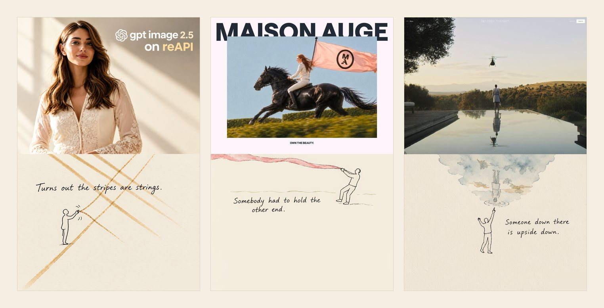

# Illustration Style skills

一组以「插画风格」为主题的视觉创作 skill 合集。



> 上半是照片，下半是纸。中间那条线，是「第二世界」开始的地方。

## 这个合集做什么

【Illustration Style skills】收录围绕插画风格视觉输出的 skill，当前聚焦 **真实摄影 ＋ 暖米白纸张 ＋ 极简黑线涂鸦** 的摄影二创海报方向。

做法不是套模板：先从一张照片里找出最有辨识度的视觉结构（斜向光影、旗面、水面倒影、头纱、枝条等），再问「这个结构若能被触碰、使用或改变，最自然会变成什么」，由此长出只属于这张照片的「第二世界」。摄影原图不做任何改动，二创只发生在下半纸面。

## 效果先看

拼图里是同一套方法落在三张不同照片上的结果，手写旁白为示例作品原样：

| # | 照片里的结构 | 纸面长出了什么 | 旁白 |
| --- | --- | --- | --- |
| 01 | 斜向的窗光条纹 | 变成可以被拨动的金色光弦 | Turns out the stripes are strings. |
| 02 | 被风带起的旗面 | 另一端被小人拽住 | Somebody had to hold the other end. |
| 03 | 泳池里的人影倒影 | 倒影里的人倒着浮上来 | Someone down there is upside down. |

<small>示例作品的摄影原图自带水印或品牌字样，按「原图零改动」保留原样。</small>

## 唯一的 skill

| # | 名称 | 对应原名 | 归类 | 适用场景 |
| --- | --- | --- | --- | --- |
| 1 | [The Truman Show Poster](skills/the-truman-show-poster/SKILL.md) | 「第二世界」 | 插画风格 · 摄影二创海报 | 手上有单张真实摄影作品，需要一张由其视觉结构长出的二创海报；尤其适用于要求摄影原图不做任何改动、AI 只负责下半纸面的场景。 |

基于一张真实摄影作品制作 3:4 竖版、上下严格 1:1 的「第二世界」海报：上半忠实保留原照片，下半为暖米白纸张并保留大量留白；照片里最具辨识度的视觉结构在纸面长成可被触碰、使用的「第二世界」，配 0–3 个极简黑色手绘线稿人物与一句简短手写旁白。整体干净、明亮、克制，带轻微手工拼贴感与独立杂志感。

当前仓库收录 1 个 skill。

## 三条硬约束

| 约束 | 说明 |
| --- | --- |
| 摄影原图零改动 | 上半由程序从原图精确裁切／等比贴入，不经过 AI 重绘；生成后把上半强制覆盖回原照片，并用像素比对验证差异为 0 |
| 二创只在下半 | 彩色元素严格只在纸面侧、不越过照片底边，色彩来自照片本身 |
| 不套模板 | 不做商业广告感、复杂插画、密集小人、固定撕纸模板、重复动作、随意装饰 |

## 目录与层级

```
Illustration Style skills/
├── README.md                          # 合集入口
├── assets/
│   └── showcase.jpg                   # 本页效果拼图
└── skills/
    └── the-truman-show-poster/        # 「第二世界」对应 skill
        └── SKILL.md                   # 该 skill 的定义文件
```

| 层级 | 内容 | 说明 |
| --- | --- | --- |
| 1 | 仓库根 | `README.md` 为唯一入口 |
| 2 | `skills/` | 按 skill 分目录，一个 skill 一个目录 |
| 3 | `skills/the-truman-show-poster/` | 单个 skill 目录，以 `SKILL.md` 作为定义 |

## 说明

- 本页仅整理已确定的信息；`Illustration Style skills`、「第二世界」、`The Truman Show Poster` 均保留原有名称与写法。
- 未新增其他世界、其他 skill 或背景设定，未添加与合集发布无关的额外功能。
